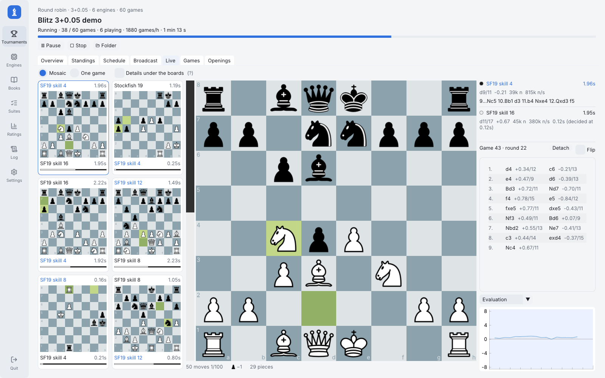
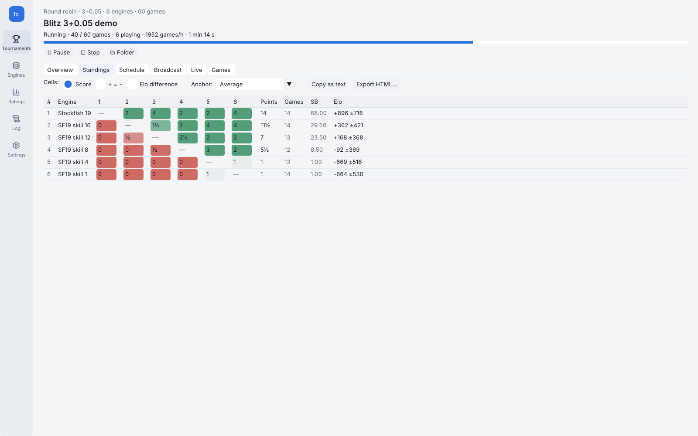
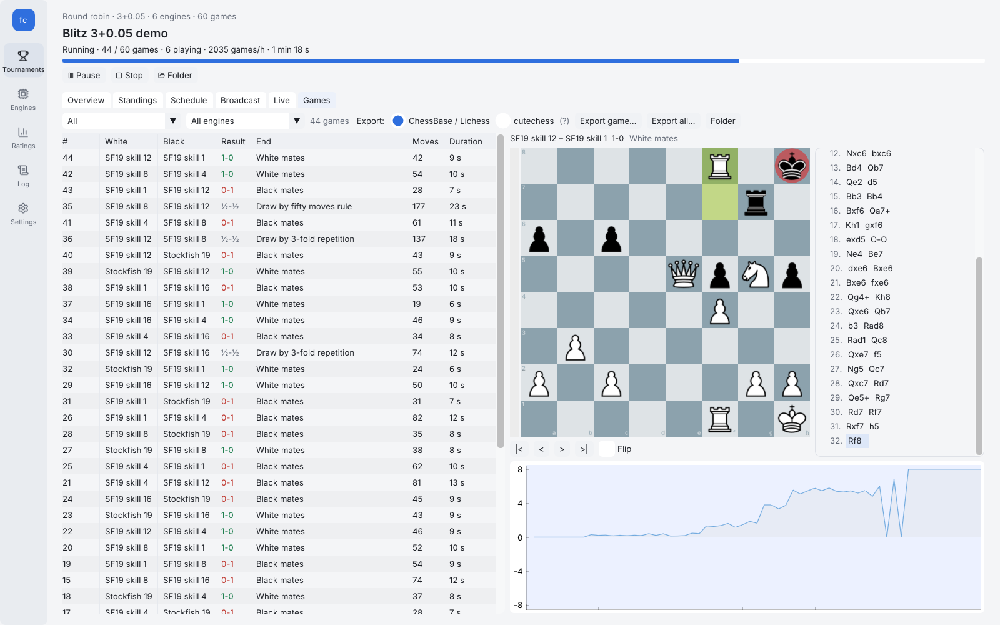
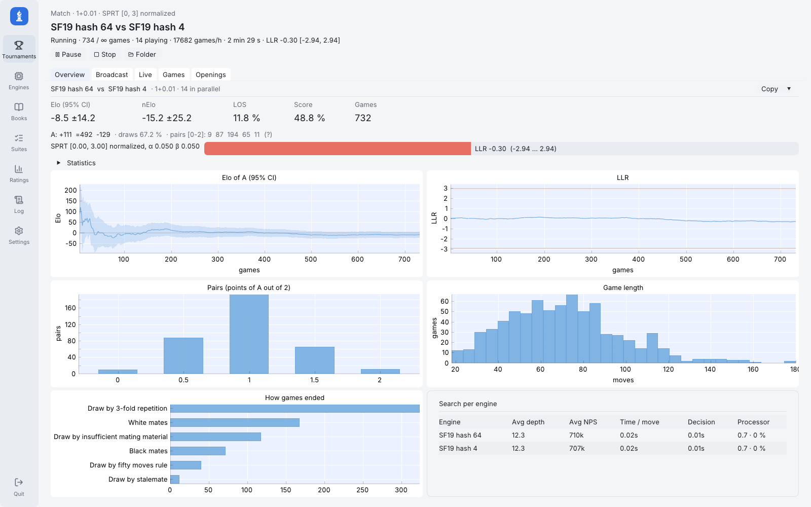

# fastchess-gui

A desktop front end for [fastchess](https://github.com/Disservin/fastchess), the chess engine tournament
manager. Two jobs: measuring whether a new version of an engine is stronger than the last one (pick two engines,
start an SPRT, follow Elo and LLR as results come in), and running engine tournaments (round robin, gauntlet,
Swiss, knockout) that resume exactly after any interruption, can be changed while they run and can be broadcast
live.



The tournament engine is fastchess itself, running inside the application (no command line parsing, no log
scraping): the games, the statistics and the SPRT are exactly those of the fastchess command line tool, which
this repository still builds unchanged.

## Features

- **Tournaments**: round robin (Berger tables, any number of cycles), gauntlet, Swiss (paired as results come, no
  rematch, byes) and knockout (seeded bracket, tiebreak pairs), with per engine Hash, Threads, nodes and time
  odds. Standings with ratings and confidence intervals, Sonneborn-Berger or Buchholz, a crosstable, export as
  text or HTML.
- **Exact resume**: every tournament is a folder with an append-only journal; after a crash, a closed window or
  a power cut it continues with no game lost or played twice.
- **Changes while running**: add, withdraw or replace an engine, change the number of cycles, play games again or
  void them, with the impact shown first. No played game is lost.
- **Broadcast**: live PGN, HTML standings and JSON files, a TLCS server for TLCV and other viewers, and a built-in
  web page.
- **Workflow**: a queue of tournaments, *Relaunch with…* a new engine version, templates, and a headless mode
  (`fastchess-gui --run`) for servers, which can broadcast too.
- **Ratings** over every tournament played (and imported PGN files), by time control, group or period, anchored on a
  reference Elo; an engine's card (results, health, rating over time), head to head records, the progress of an
  engine's versions, an export for Ordo and BayesElo.
- **Matches**: a fixed number of games, unlimited, or an SPRT (normalized, logistic or BayesElo model, with
  gainer and non-regression presets). Time control (base + increment, moves per period), time per move, fixed
  nodes or fixed depth.
- **Concurrency** detected at startup: one game per hardware thread at fixed nodes or depth, physical cores − 1
  with a clock. Optional CPU affinity.
- **Live view**: every game in progress as a mosaic, or one in focus, with the board, clocks, the running search of each engine
  (depth, score, nodes, nps, win/draw/loss shares, PV in SAN), the annotated move list and the evaluation and WDL
  curves; under the board, the
  50-move counter, the material and the pieces left. Boards can be detached into their own windows.
- **Fair play**: the processor time of every engine, while it thinks and while its opponent does, with a warning
  when it uses more cores than its threads or thinks on its opponent's time.
- **Pause / resume** without losing anything: no new game pair starts, running games (and the second game of
  their pair) play to the end. Stop either after the running games or immediately.
- **Games**: every finished game, filterable, with a replay board and evaluation curve. Each game is written to
  two PGN files, `{+0.35/18 1.234s}` (cutechess style) and `{[%eval 0.35,18] [%clk …] [%emt …]}`
  (ChessBase / Fritz / Lichess), and can be exported in either.
- **Results and charts**: Elo and nElo with 95 % confidence interval, LOS, pentanomial counts, LLR against its
  bounds, Elo and LLR over time, game lengths, how games ended, average depth and NPS per engine.
- **Engines**: UCI options are read from the engine and edited in a table; only values that differ from the
  default are sent. A health check, groups, a reference Elo, and the import of ChessGUI, cutechess, Banksia and
  Arena engine lists. WinBoard engines too, through a translation to UCI built in.
- **Opening books**: EPD, PGN or Polyglot, in a library; each book checked for illegal, duplicate, mirrored and
  finished positions, browsed on a board, and cleaned. Results by opening after a tournament: the unbalanced, the
  drawish and the decisive ones, exported as EPD.
- **Test suites** (STS, WAC, ERET…): several engines on the positions of an EPD file (`bm`, `am`, STS points),
  as a grid with the time to solution, the totals and the STS score, saved to compare versions, exported as CSV.
- Chess960 (the 960 positions, or a book), draw / resign / max moves / Syzygy
  adjudication, crash recovery, a desktop notification when a match ends.
- Light and dark themes; English, French or German, following the system (can be changed in the settings).

| Standings and crosstable | Games and replay |
|---|---|
|  |  |

| A two-engine SPRT match |
|---|
|  |

## Building

A C++20 compiler and CMake 3.24 or newer. SDL3, Dear ImGui (docking branch), ImPlot, nanosvg,
stb_image_write and the Inter and Lucide fonts are downloaded by CMake at pinned versions and linked statically.

```bash
# Linux
cmake -B build -G Ninja -DCMAKE_BUILD_TYPE=Release
cmake --build build
./build/fastchess-gui

# Windows, cross-compiled from Linux with mingw-w64
cmake -B build-win -G Ninja -DCMAKE_BUILD_TYPE=Release -DCMAKE_TOOLCHAIN_FILE=cmake/mingw-w64.cmake
cmake --build build-win
# build-win/fastchess-gui.exe is self-contained (it only imports system DLLs)
```

The build also produces `fastchess` (the upstream command line tool, from the same sources),
`fcg-tournament-tests` and `fastchess-gui-tests`:

```bash
./build/fcg-tournament-tests                   # tournament library: schedules, journal, resume, pairings, ratings
./build/fastchess-gui-tests                    # GUI tests, including real tournaments with a mock engine
make -C app tests && ./app/fastchess-tests     # upstream fastchess tests, run from the repository root
```

## Using it

1. **Engines**: *Add…* a UCI executable, or *Import…* the engine list of another program. Options are read
   automatically. *Duplicate* gives the same binary with other options (`Hash`, `Threads`, a skill level…).
2. **Tournaments → New tournament**: the format (a two-engine match, round robin, gauntlet, Swiss, knockout), the
   engines, the time control, concurrency, the opening book and adjudication. For a match, engine A is the one
   being tested (statistics are from its point of view) and engine B the baseline.
3. **Start**, or *Add to the queue*.

Everything is stored in the profile folder (`~/.local/share/fastchess/fastchess-gui/` on Linux,
`%APPDATA%\fastchess\fastchess-gui\` on Windows): the engine library, the last setup, templates, the queue,
and one folder per tournament under `runs/` with its description, its journal and both PGN files.

The [user guide](docs/guide.md) covers every setting, window and file in detail.

## Relationship with fastchess

This is a fork of fastchess. The command line tool, its Makefile and its 167 tests are untouched in behaviour.
The GUI only adds hooks that do nothing until an observer is installed (the command line tool never installs
one):

- `app/src/core/observer.hpp`: the `GameObserver` interface (game start, thinking, the lines read from and sent
  to the engines, moves, game end, statistics) and the pair aware `PauseGate`;
- a worker index per thread in the thread pool, plus a fix for `ThreadPool::resize`, which created 2N entries
  for N threads;
- a ChessBase comment style in `PgnBuilder`;
- `Logger::setPrintSink`, which feeds the console window;
- `UciEngine::pid()` and `setInputCallback()`, for the processor time and the engine logs;
- on Windows, `CREATE_NO_WINDOW` when the parent has no console, so engines do not open console windows.
- `BaseTournament::saveJson()` does nothing without a configuration file name, so a tournament run by the GUI
  leaves no `config.json` next to its own files.

The tournaments themselves (schedules, pairings, journal, resume, standings, ratings) are a separate library,
`tournament/`, whose runner derives from fastchess' `BaseTournament`; see
[docs/design/tournament.md](docs/design/tournament.md).

The original fastchess README is kept as [README.fastchess.md](README.fastchess.md).

## License

MIT, like fastchess (see [LICENSE](LICENSE)). The piece set is Colin M.L. Burnett's, used under the BSD license;
see [gui/assets/ATTRIBUTION.md](gui/assets/ATTRIBUTION.md) for the assets and libraries.
