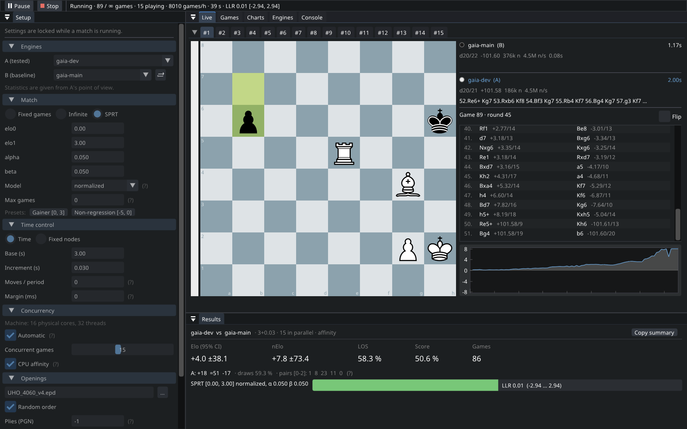
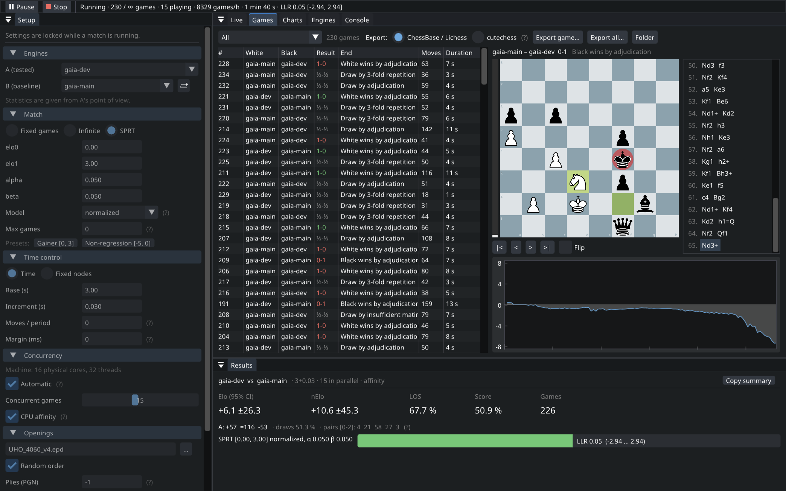
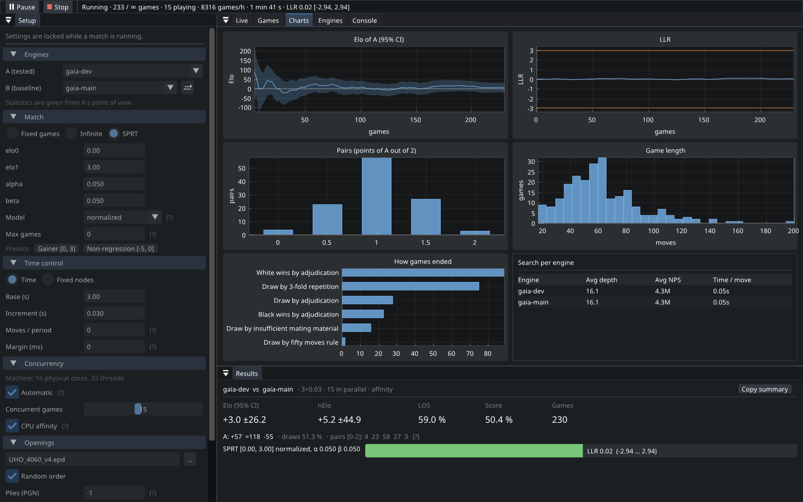

# fastchess-gui

A small desktop front end for [fastchess](https://github.com/Disservin/fastchess), the chess engine tournament
manager: pick two engines, start a match, watch the games live, and follow Elo and SPRT as results come in.
It is meant for one job: measuring whether a new version of an engine is stronger than the last one.



The tournament engine is fastchess itself, running inside the application (no command line parsing, no log
scraping): the games, the statistics and the SPRT are exactly those of the fastchess command line tool, which
this repository still builds unchanged.

## Features

- **Matches**: a fixed number of games, unlimited, or an SPRT (normalized, logistic or BayesElo model, with
  gainer and non-regression presets). Time control (base + increment, moves per period) or fixed nodes.
- **Concurrency** detected at startup: one game per hardware thread at fixed nodes, physical cores − 1 with a
  clock. Optional CPU affinity.
- **Live view**: one tab per concurrent game, with the board, clocks, the running search of each engine
  (depth, score, nodes, nps, PV in SAN), the annotated move list and the evaluation curve.
- **Pause / resume** without losing anything: no new game pair starts, running games (and the second game of
  their pair) play to the end. Stop either after the running games or immediately.
- **Games**: every finished game, filterable, with a replay board and evaluation curve. Each game is written to
  two PGN files, `{+0.35/18 1.234s}` (cutechess style) and `{[%eval 0.35,18] [%clk …] [%emt …]}`
  (ChessBase / Fritz / Lichess), and can be exported in either.
- **Results and charts**: Elo and nElo with 95 % confidence interval, LOS, pentanomial counts, LLR against its
  bounds, Elo and LLR over time, game lengths, how games ended, average depth and NPS per engine.
- **Engines**: UCI options are read from the engine and edited in a table; only values that differ from the
  default are sent.
- Opening books (EPD/PGN), draw / resign / max moves / Syzygy adjudication, crash recovery, a desktop
  notification when a match ends.
- English or French, following the system language (can be changed in the settings).

| Games and replay | Charts |
|---|---|
|  |  |

## Building

A C++20 compiler and CMake 3.24 or newer. SDL3, Dear ImGui (docking branch), ImPlot, nanosvg and
stb_image_write are downloaded by CMake at pinned versions and linked statically.

```bash
# Linux
cmake -B build -G Ninja -DCMAKE_BUILD_TYPE=Release
cmake --build build
./build/fastchess-gui

# Windows, cross-compiled from Linux with mingw-w64
cmake -B build-win -G Ninja -DCMAKE_BUILD_TYPE=Release -DCMAKE_TOOLCHAIN_FILE=cmake/mingw-w64.cmake
cmake --build build-win
# build-win/fastchess-gui.exe is self-contained (it only imports system DLLs)
```

The build also produces `fastchess` (the upstream command line tool, from the same sources) and
`fastchess-gui-tests`:

```bash
./build/fastchess-gui-tests                    # GUI tests, including real tournaments with a mock engine
make -C app tests && ./app/fastchess-tests     # upstream fastchess tests, run from the repository root
```

## Using it

1. **Engines**: *Add…* a UCI executable. Its options are read automatically. *Duplicate* gives the same binary
   with other options (`Hash`, `Threads`, a skill level…).
2. **Setup**: engine A (the one being tested; statistics are from its point of view) and engine B (the
   baseline), the kind of match, the time control, concurrency, the opening book and adjudication.
3. **Start**.

Everything is stored in the profile folder (`~/.local/share/fastchess/fastchess-gui/` on Linux,
`%APPDATA%\fastchess\fastchess-gui\` on Windows): the engine list, the last setup, the window layout, and one
folder per match under `runs/` with both PGN files and fastchess' own `config.json`.

The [user guide](docs/guide.md) covers every setting, window and file in detail.

## Relationship with fastchess

This is a fork of fastchess. The command line tool, its Makefile and its 165 tests are untouched in behaviour.
The GUI only adds hooks that do nothing until an observer is installed (the command line tool never installs
one):

- `app/src/core/observer.hpp`: the `GameObserver` interface (game start, thinking, engine output lines, moves,
  game end, statistics) and the pair aware `PauseGate`;
- a worker index per thread in the thread pool, plus a fix for `ThreadPool::resize`, which created 2N entries
  for N threads;
- `IProcess::setLineObserver`, to read engine output as it arrives;
- a ChessBase comment style in `PgnBuilder`;
- `Logger::setPrintSink`, which feeds the console window;
- on Windows, `CREATE_NO_WINDOW` when the parent has no console, so engines do not open console windows.

The original fastchess README is kept as [README.fastchess.md](README.fastchess.md).

## License

MIT, like fastchess (see [LICENSE](LICENSE)). The piece set is Colin M.L. Burnett's, used under the BSD license;
see [gui/assets/ATTRIBUTION.md](gui/assets/ATTRIBUTION.md) for the assets and libraries.
